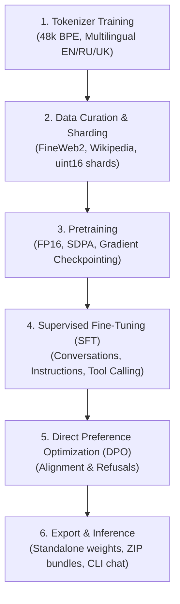

# Seto

[](https://www.python.org/)
[](#development-status)

Seto is an experimental tiny language model project focused on efficient local inference on laptops, smartphones, and resource-constrained devices.

---

## Overview

Seto explores high-efficiency language modeling trained from scratch under strict compute budgets (such as dual-GPU Kaggle/Colab setups) and tuned for edge execution.

### Key Priorities & Feature Status

- **Parameter Budget**: Models up to 2 billion parameters, prioritizing compact variants (**Seto Tiny / Daily**).
- **Training from Scratch**: Purpose-built multilingual tokenization, data curation, pretraining, and alignment pipelines.
- **Multilingual Support**: Balanced 48k BPE tokenization trained across Russian (80%), Ukrainian (10%), and English (10%).
- **Tool Calling & Agentic Capabilities**: *(Planned / Prototype)* Special tokens and target loss masking implemented for `<|tool_call|>` and `<|tool_result|>`; full agentic execution workflows remain in development.
- **Edge Deployment**: *(Planned / Prototype)* Architecture optimized for low-memory footprint (GQA, tied embeddings); export pipelines to specialized mobile/edge runtimes (e.g. GGUF, ONNX) are planned.

> [!NOTE]
> **Development Status**: Experimental research stage. The model is not yet fully trained, benchmarked, or released. Scripts and architectures in this repository represent active prototypes under evaluation rather than finalized artifacts.

---

## Architecture Summary

Current experimental model configurations:

| Parameter | Tiny (~200M) | Small (~500M) | Base / 1B (~1.1B) |
| :--- | :--- | :--- | :--- |
| `d_model` | 1024 | 1280 | 2048 |
| Layers | 14 | 24 | 22 |
| Heads (Q / KV) | 16 / 4 (GQA) | 20 / 5 (GQA) | 16 / 4 (GQA) |
| FFN Dimension | 2816 (SwiGLU) | 3584 (SwiGLU) | 5504 (SwiGLU) |
| Context Length | 1024 | 2048 | 2048 |
| Vocabulary | 48,000 BPE | 48,000 BPE | 48,000 BPE |
| Positional Embeddings | RoPE | RoPE | RoPE |
| Attention | SDPA + GQA | SDPA + GQA | SDPA + GQA |
| Normalization | RMSNorm | RMSNorm | RMSNorm |

For detailed breakdown, memory strategies, and layer formulations, refer to [docs/ARCHITECTURE.md](docs/ARCHITECTURE.md).

---

## Pipeline

Seto implements an end-to-end training and alignment lifecycle:



---

## Project Structure

```
seto/
├── configs/            # SFT corpus and run configurations
├── datasets/           # Fixtures, test datasets, and validation manifests
│   └── validation/     # Curated validation split guides
├── docs/               # Extended documentation
│   ├── ARCHITECTURE.md # Architectural specifications and design notes
│   ├── DATA_AND_SFT.md # Data provenance, filtering, and SFT smoke test protocol
│   └── ROADMAP.md      # Development milestones and priorities
├── notebooks/          # Training notebooks and single-cell scripts (Kaggle/Colab)
├── scripts/            # CLI utilities: data prep, training, filtering, chat
├── seto/               # Core library
│   ├── config.py       # ModelConfig, TrainConfig dataclasses
│   ├── model.py        # Transformer implementation (GQA, RoPE, SwiGLU)
│   ├── tokenizer.py    # Custom BPE tokenizer wrapper & special tokens
│   ├── trainer.py      # Pretraining loop, memory optimizations, checkpointing
│   ├── sft.py          # Supervised fine-tuning trainer & packing
│   ├── dpo.py          # Direct Preference Optimization trainer
│   └── data.py         # Streaming dataset loaders & binary shard parsers
├── CONTRIBUTING.md     # Guidelines for contributors
└── pyproject.toml      # Project dependencies and tool settings
```

---

## Getting Started

### Installation

Clone the repository and install dependencies in a virtual environment:

```bash
git clone https://github.com/dustincorder/seto.git
cd seto

python3 -m venv .venv
source .venv/bin/activate

pip install -e .
```

For development tooling (linters and testing tools):

```bash
pip install -e ".[dev]"
```

---

## Usage Workflow

### 1. Tokenizer & Shard Preparation

Train the 48k BPE tokenizer:

```bash
python scripts/prepare_data.py --output-dir data --tokenizer-dir seto-tokenizer
```

Tokenize and pack raw pretraining text into `uint16` binary shards:

```bash
python scripts/prepare_data.py --output-dir data --tokenizer-dir seto-tokenizer --skip-tokenizer
```

### 2. Pretraining

Run distributed pretraining with `torchrun`:

```bash
torchrun --nproc_per_node=2 scripts/train.py \
  --stage pretrain \
  --model-config tiny \
  --data-dir data/shards \
  --output-dir output
```

### 3. SFT Alignment & Multi-Turn Mixing

Prepare and filter conversational datasets:

```bash
# Convert reviewed OpenAssistant dialogues
python scripts/prepare_oasst.py \
  --languages ru,en --max-turns 12 --max-chars 12000 \
  --min-reviews 1 \
  --output datasets/sft/oasst1.jsonl \
  --metadata-output datasets/sft/oasst1.meta.jsonl \
  --manifest-output datasets/sft/oasst1.manifest.json

# Build balanced weighted SFT corpus
python scripts/mix_sft.py \
  --config configs/sft-v1.json \
  --output datasets/sft/seto-sft-v1.jsonl \
  --metadata-output datasets/sft/seto-sft-v1.meta.jsonl \
  --manifest-output datasets/sft/seto-sft-v1.manifest.json
```

For data provenance specifications, rejection filtering, and the SFT smoke-test protocol, see [docs/DATA_AND_SFT.md](docs/DATA_AND_SFT.md).

Run SFT training from an existing pretraining checkpoint:

```bash
python scripts/train.py \
  --stage sft \
  --model-config tiny \
  --dataset datasets/sft/seto-sft-v1.jsonl \
  --tokenizer seto-tokenizer \
  --init-from output/final_pretrain.zip \
  --output-dir output-sft
```

### 4. Interactive Chat

Run inference using a trained checkpoint directory or packaged ZIP bundle:

```bash
# Interactive conversation
python scripts/chat.py --model output/final_sft.zip

# One-shot prompt
python scripts/chat.py --model output/final_sft.zip --prompt "Hello! What can you do?"
```

---

## Roadmap

See [docs/ROADMAP.md](docs/ROADMAP.md) for milestone tracking, architecture exploration plans, and post-training schedules.

---

## Contributing

Contributions and issue discussions are welcome. Please read [CONTRIBUTING.md](CONTRIBUTING.md) for setup instructions and code style conventions.

---

## License

A formal license file has not yet been designated for this repository. See [pyproject.toml](pyproject.toml) or open an issue for licensing inquiries.
