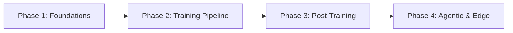

# Project Roadmap

This document outlines the current development priorities, active milestones, and long-term directions for Seto.

## Focus & Principles

- **Compact Scale**: Parameter regimes up to 2 billion parameters (primary target: Seto Tiny / Daily).
- **Edge Deployment**: Prioritizing CPU and low-power GPU inference on consumer laptops and smartphones.
- **Multilingual Focus**: Native support and balanced tokenization for English, Russian, and Ukrainian.
- **Clean Training Loop**: Training from scratch with minimal external dependencies.

---

## Phases

### Phase 1: Foundations & Architecture Exploration (In Progress)
- [x] Baseline Transformer architecture (GQA, RoPE, RMSNorm, SwiGLU).
- [x] Shared vocabulary tokenizer (48k BPE) covering EN, RU, UK and tool tokens.
- [x] Memory-efficient training primitives (activation checkpointing, chunked cross-entropy, 8-bit AdamW).
- [ ] Systematic architecture benchmarks and evaluation of alternative attention/block variants.
- [ ] Finalize target architecture specifications for production runs.

### Phase 2: Pretraining at Scale
- [x] Data ingestion pipeline for web corpora (FineWeb2, Wikipedia).
- [x] uint16 binary shard tokenization and streaming dataset loader.
- [ ] Pretraining run for Seto Tiny (~200M) on curated multilingual corpus.
- [ ] Pretraining run for intermediate variants (up to ~1B-2B).
- [ ] Pretraining learning rate cooldown protocols and checkpoint evaluations.

### Phase 3: Post-Training (SFT & Alignment)
- [x] Canonical message format schema and dataset conversion tools (`prepare_oasst.py`, `clean_sft.py`).
- [x] Quality and refusal filtering utilities (`sft_filter.py`).
- [x] Weighted multi-source mixer (`mix_sft.py`).
- [x] SFT training script with packed-turn target loss masking (`seto/sft.py`).
- [x] DPO alignment trainer module prototype (`seto/dpo.py`).
- [ ] Full SFT alignment execution across instruction, dialogue, and reasoning datasets.
- [ ] Preference optimization (DPO) on target evaluation pairs.

### Phase 4: Edge Deployment & Agentic Capabilities
- [ ] Export pipelines for edge runtimes (ONNX, GGUF/llama.cpp, Apple CoreML).
- [ ] Native tool calling and function invocation validation.
- [ ] Agentic prompt conventions and constrained decoding support.
- [ ] Automated evaluation suite across multilingual benchmarks and reasoning tasks.
